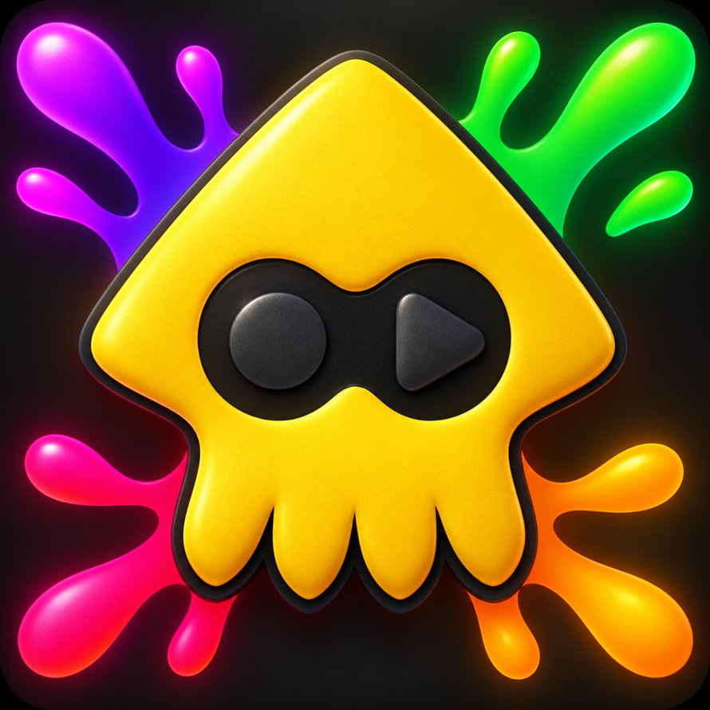
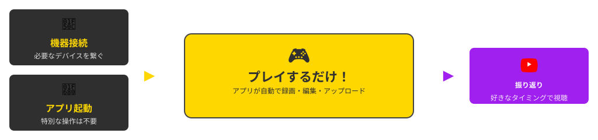
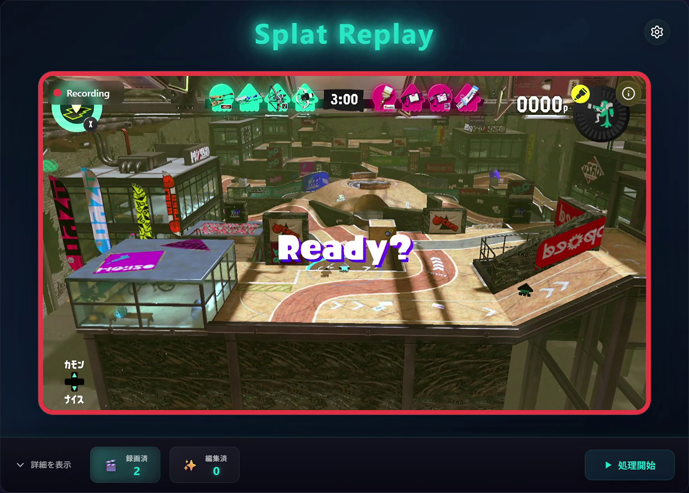

<!-- markdownlint-disable MD033 MD041 -->
<!-- 理由: アイコン付きタイトルの中央揃えには HTML が必要（MD033）、視覚的な表現を優先（MD041） -->
<!-- 将来の解消方針: GitHub の Markdown レンダリングが画像+テキストの flexbox 配置をサポートするか、別の表現方法を検討 -->

  <h1 style="display: flex; align-items: center; justify-content: center;">
    
    Splat Replay
  </h1>

<!-- markdownlint-enable MD033 MD041 -->

Splat Replay は、スプラトゥーン 3 のプレイ動画を自動で録画・編集・アップロードするアプリです。一連の処理を自動化することで、プレイに集中しながら記録を残せます。

## 主な機能

- **自動録画**:  
  映像をリアルタイムで監視し、バトル開始・終了に応じて録画を開始・停止します。録画には OBS を使用しています。

- **自動編集**:  
  録画した動画をタイムスケジュール毎に結合し、サムネイルを自動生成します。

- **自動アップロード**:  
  編集した動画を YouTube にアップロードします。タイトル・説明・サムネイル・字幕を合わせて設定します。

## 使い方

### インストール

Windows 11 と Apple Silicon 搭載の macOS に対応しています。

**Windows**

1. [GitHub リリースページ](https://github.com/saw4405/splat-replay2/releases)にある最新のリリースから、`SplatReplay.zip` をダウンロードする
2. ダウンロードした ZIP ファイルを展開する

**macOS（Apple Silicon）**

1. [GitHub リリースページ](https://github.com/saw4405/splat-replay2/releases)で macOS 用 DMG が掲載されているリリースからダウンロードする
2. DMG を開き、`SplatReplay.app` を「アプリケーション」へドラッグして、DMG を取り出す

macOS 版は自己署名・公証なしのため、初回にシステム設定から起動を許可する場合があります。[macOS の導入手順](./docs/usage.md#macos-apple-silicon)を参照してください。

### 起動

1. Windows は展開したフォルダの `SplatReplay.exe`、macOS は「アプリケーション」の `SplatReplay.app` を開く
2. 初回はセットアップウィザードに従い、録画・判定・編集・YouTube アップロードに必要なソフトと設定をそろえる。不足がある場合は通常画面へ進む前に修復する
3. Switch の映像を監視し、設定に応じてバトルを自動録画する。編集・アップロードは「処理開始」から手動で行うか、対応設定を有効にして電源 OFF 検出後の予告から開始する

詳しい設定と日常の使い方は[ユーザーガイド](./docs/usage.md)を参照してください。

## 開発者向け情報

このプロジェクトの開発に参加する場合は、以下のドキュメントを参照してください：

- **[開発ガイド](./docs/DEVELOPMENT.md)** - 環境構築、テスト実行、品質確認の手順
- [テスト戦略](./docs/test_strategy.md) - テストの分類と戦略の詳細
- [動画リプレイ入力による E2E 回帰テスト](./docs/e2e_replay_test.md) - E2E テストの詳細

### サムネイルのルール名画像

ルール名は `backend/assets/thumbnail/rule-labels/` の白文字・透明PNG6枚で表示します。字面は高さ135px・幅532px、配置は左1120px・上71px（下端206px）です。勝敗・レート用のPaintballは別用途として維持します。

通常録画とファイル取り込みは同じ画像生成器を使用します。画像が欠損・不正な場合は、文字フォントに切り替えず画像のパスを含むエラーで停止します。セットアップに画像確認手順はありません。旧設定の廃止手順は読み込み時に移行します。

トリカラはマッチ用アイコンが存在しますが、ルール用アイコン `トリカラ.png` は未収録です。該当アイコンを省略して警告を記録し、別ルールの画像では代用しません。

本人指定によりCanvaで作成した文字画像をassetsへ同梱する構成です。ただしCanva素材の公開アプリへの再配布許諾は未確認です。このローカル実装を、外部push・リリース・商用配布の許諾確認済みという意味には扱いません。
